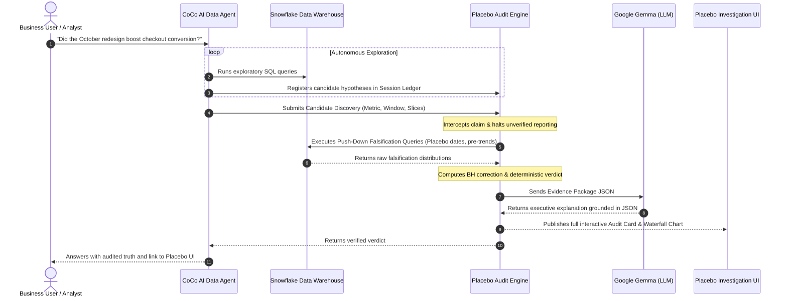

# Project Placebo: The Falsification & Statistical Audit Layer for AI Data Agents
**Team Briefing & Technical Architecture Guide**

---

## 1. What Are We Building? (Executive Summary)

**Placebo** is an open-source **statistical audit and active falsification layer** built for modern AI data agents.

When AI agents query corporate data warehouses, they don't just ask one question—they test dozens of variations, segments, time windows, and metrics in seconds. While this looks like supercharged productivity, it creates a massive statistical vulnerability: **if you search enough random noise, you are guaranteed to find patterns that look statistically significant but are completely fake.**

Placebo sits between the AI Data Agent (such as **CoCo**) and the Cloud Data Warehouse (such as **Snowflake**). It acts as an impartial, automated scientific reviewer:
1. **Hypothesis Ledger:** Silently logs every single query and hypothesis the AI tests.
2. **Multiplicity Correction:** Automatically discounts "statistically significant" findings if they were mined from a massive search space.
3. **Active Falsification:** Executes rigorous stress tests on the warehouse (e.g., *What if we pretend the feature launched 6 months before it actually did?*).
4. **Deterministic Verdict:** Issues an evidence-backed grade (`CONFIRMED`, `INCONCLUSIVE`, or `REFUTED`).
5. **Grounded Translation:** Uses **Google Gemma** to explain the statistical proof in plain English—strictly forbidding the LLM from inventing or calculating numbers.

---

## 2. The Core Building Blocks: Snowflake & CoCo

To understand how Placebo operates, every teammate must understand the two platforms it connects:

```
┌─────────────────────────────────────────────────────────────┐
│                   1. CoCo (AI Data Agent)                   │
│   "Conversational analyst that writes SQL & tests ideas"    │
└──────────────────────────────┬──────────────────────────────┘
                               │
                               ▼
┌─────────────────────────────────────────────────────────────┐
│                ★ PLACEBO (Audit & Falsify)                  │
│   "Ledger + Falsification Battery + Deterministic Verdict"   │
└──────────────────────────────┬──────────────────────────────┘
                               │
                               ▼
┌─────────────────────────────────────────────────────────────┐
│                 2. Snowflake (Data Warehouse)                │
│       "Massive enterprise database holding raw truth"        │
└─────────────────────────────────────────────────────────────┘
```

### What is Snowflake?
- **In Simple Terms:** A massive, ultra-fast digital warehouse where companies store all their business records (every purchase, login, click, subscription, and server event).
- **In Technical Terms:** A cloud-native, multi-tenant, elastic Data Warehouse (SQL OLAP) that separates storage from compute. It enables running complex analytical queries over petabytes of structured and semi-structured data with instant horizontal scaling.
- **Why It Matters Here:** Snowflake is where the raw data lives. Placebo uses Snowflake not just to verify data, but to execute **push-down SQL falsification queries** (e.g., placebo date slices, pre-trend difference calculations) directly inside Snowflake's compute engine without moving millions of rows to local memory.

### What is CoCo?
- **In Simple Terms:** An autonomous AI coworker designed for data analysis. You ask it: *"Why did checkout conversion drop in Germany last week?"*, and CoCo plans the query strategy, writes the SQL, executes it, and gives you an answer.
- **In Technical Terms:** A context-aware conversational agent architecture. It uses LLMs to break down ambiguous business questions, interact with SQL databases, iteratively refine hypotheses, and produce summarized findings.
- **Why It Matters Here:** CoCo is the **explorer**. Left unchecked, CoCo can execute 50 SQL queries in 2 minutes, slice data by 20 dimensions, and stumble upon false correlations. Placebo provides the **CoCo Skill / Guardrail** that forces CoCo to register hypotheses and subject any "breakthrough discovery" to scientific verification before reporting it to humans.

---

## 3. The Problem: The Illusion of Discovery

### Why AI Data Agents Break Standard Statistics

In traditional data science, a human analyst formulates **one or two hypotheses**, writes SQL carefully, runs an A/B test analysis, and publishes the result.

An AI agent, however, has infinite patience and near-zero compute latency. If you ask an agent:
> *"Find out if our new checkout redesign improved purchase rates."*

The AI agent will automatically check:
- Overall conversion... *(Not significant, p = 0.28)*
- Mobile users only... *(Not significant, p = 0.42)*
- iOS users only... *(Not significant, p = 0.19)*
- iOS users in Europe... *(Not significant, p = 0.31)*
- iOS users in France on weekends between 6 PM and 10 PM... *(**Significant! +18% lift, p = 0.008!**)*

The agent triumphantly reports:
> *"Breakthrough: The redesign boosted French iOS weekend conversion by 18% (p < 0.01)!"*

**This is a mathematical illusion.** If you flip a fair coin 20 times, there is a ~64% chance you will see a streak of 4 heads in a row somewhere. The agent didn't find a genuine business effect; it simply searched the noise until it found a statistical accident.

---

## 4. Glossary: Key Concepts Explained

Every member of our engineering and data team needs to speak the same language:

| Term | Simple Definition (Layman) | Technical / Mathematical Definition |
| :--- | :--- | :--- |
| **Null Hypothesis ($H_0$)** | The assumption that nothing actually happened (no real difference, no effect). | $H_0: \mu_{\text{treatment}} - \mu_{\text{control}} = 0$. The default stance that observed differences stem solely from sampling variation. |
| **p-value** | The probability that pure random luck could fool you into seeing this result. | $P(\text{Data} \mid H_0)$. Probability of obtaining test results at least as extreme as observed, assuming $H_0$ is true. |
| **Statistical Significance ($\alpha = 0.05$)** | The arbitrary rule of thumb that says "less than 5% chance of being luck means it's real." | Significance threshold $\alpha$. If $p < \alpha$, we reject $H_0$ at a 5% Type I error tolerance. |
| **Multiple Testing Problem** | If you roll a 20-sided die enough times, rolling a "1" is inevitable, not special. | If you perform $m$ independent tests at $\alpha = 0.05$, the Family-Wise Error Rate (FWER) escalates: $\alpha_{\text{total}} = 1 - (1 - \alpha)^m$. At $m=40$, error probability is $> 87\%$. |
| **p-hacking / Data Dredging** | Testing data over and over in different ways until a low p-value pops up, then hiding the failed attempts. | Exploiting researcher degrees of freedom by iteratively tweaking sample filters, covariates, or splits until $p < 0.05$. |
| **Post-Hoc Hypothesizing (HARKing)** | Shooting an arrow at a blank wall and then drawing a bullseye around where it hit. | **H**ypothesizing **A**fter the **R**esults are **K**nown. Framing a data-mined serendipity as if it were a pre-specified hypothesis. |
| **Benjamini-Hochberg (BH) Procedure** | A fair mathematical penalty that raises the standard of proof based on how many things you looked at. | False Discovery Rate (FDR) controlling method: sorts $m$ p-values $p_{(1)} \le \dots \le p_{(m)}$ and finds the largest $k$ such that $p_{(k)} \le \frac{k}{m} Q$. |
| **Pre-Trend Confounding** | Claiming the medicine cured the patient, when the patient was already getting better before taking it. | Violation of the parallel-trends assumption in quasi-experimental designs ($Y_{t} - Y_{t-1} \neq 0$ prior to intervention $T_0$). |
| **Placebo Date Test (In-Time Placebo)** | Pretending the event happened 3 months early. If the "effect" still appears, the real event wasn't the cause. | Setting artificial intervention timestamps $T_{\text{fake}} < T_{\text{actual}}$ on pre-period data to test for spurious treatment effect $E[\tau_{\text{fake}}] \neq 0$. |
| **Leave-One-Out Sensitivity** | Checking if the entire "discovery" was driven by one single whale customer or a single glitchy day. | Jackknife estimation / influence diagnostics. Computing $\Delta \tau_{-i} = \tau_{\text{full}} - \tau_{(-i)}$ to measure leverage of individual data clusters. |

---

## 5. Existing Solutions & Why They Fail Today

| Existing Tool / Approach | How It Works | Why It Fails for AI Data Agents |
| :--- | :--- | :--- |
| **Manual Peer Review** | Senior human data scientists audit pull requests and query logic. | **Far too slow.** A human takes 2 days to review an analysis. An AI agent runs 100 analyses an hour. Human review cannot scale. |
| **BI Dashboards (Tableau, Looker)** | Pre-computed, fixed charts and metric definitions. | **Too rigid.** BI dashboards cannot answer exploratory, ad-hoc, multi-dimensional causal questions. |
| **SQL Linters & Syntax Checkers** | Check table schema, syntax, join safety, and query performance. | **Statistically blind.** SQL can be 100% syntactically correct and run in 50ms, while producing completely bogus causal claims. |
| **LLMs Reviewing Themselves** | Asking GPT-4 / Claude: *"Are you sure about this statistical conclusion?"* | **Confirmation bias & hallucination.** LLMs cannot reliably perform matrix math, calculate standard errors, or verify data distributions in their heads. |

---

## 6. Our Approach: How Placebo Solves This

Placebo operates on three ironclad principles:
1. **Exploration is free; verification is strict.** We do not restrict the AI's ability to brainstorm or search Snowflake.
2. **Code calculates; the LLM only translates.** All p-values, corrections, and falsification statistics are computed deterministically using standard scientific Python libraries (`scipy`, `statsmodels`).
3. **Every finding must survive deliberate sabotage.** If an effect is real, it must hold up when subjected to counterfactual stress testing.

### The 5 Architectural Pillars

```
                     ┌──────────────────────────────────────┐
                     │          1. HYPOTHESIS LEDGER        │
                     │  Logs search tree, parameters, scope │
                     └──────────────────┬───────────────────┘
                                        ▼
                     ┌──────────────────────────────────────┐
                     │     2. MULTIPLICITY CORRECTION       │
                     │  Benjamini-Hochberg / Bonferroni     │
                     └──────────────────┬───────────────────┘
                                        ▼
                     ┌──────────────────────────────────────┐
                     │    3. FALSIFICATION TEST BATTERY     │
                     │  • Placebo Dates  • Pre-trend check  │
                     │  • Placebo Cohort • Leave-one-out    │
                     └──────────────────┬───────────────────┘
                                        ▼
                     ┌──────────────────────────────────────┐
                     │          4. VERDICT ENGINE           │
                     │  Deterministic logic:                │
                     │  CONFIRMED | INCONCLUSIVE | REFUTED  │
                     └──────────────────┬───────────────────┘
                                        ▼
                     ┌──────────────────────────────────────┐
                     │        5. GROUNDED EXPLANATION       │
                     │  Google Gemma 3 27B:                 │
                     │  Translates structured evidence card │
                     └──────────────────────────────────────┘
```

#### 1. Hypothesis Ledger
Tracks the lineage of the discovery:
- How many queries did the agent execute during this session?
- How many candidate metrics and dimension slices were inspected?
- What was the initial raw p-value vs. the family size $m$?

#### 2. Multiplicity Correction Engine
Calculates adjusted significance:
- Applies Benjamini-Hochberg (BH) FDR or Holm-Bonferroni based on hypothesis independence.
- If raw $p = 0.012$, but the agent checked 47 combinations, the adjusted $p = 0.31$ $\rightarrow$ **Immediate red flag.**

#### 3. Active Falsification Battery
Runs targeted validation queries against Snowflake:
- **Test A: In-Time Placebos:** Picks 5 pseudo-intervention dates prior to the actual launch. If 3 out of 5 show the same "+15% boost", the effect is an ongoing trend, not the feature.
- **Test B: Pre-Trend Test:** Runs regression on pre-intervention periods to ensure the metric was flat before the event.
- **Test C: Leave-One-Out (Jackknife):** Removes the top 1% volume cluster/entity. Does the effect vanish? If yes, it was an outlier anomaly.

#### 4. The Verdict Engine (Zero Hallucination)
A deterministic decision matrix:
- **`CONFIRMED`:** Survived multiple testing ($p_{\text{adj}} < 0.05$), flat pre-trend ($p > 0.10$), passed $\ge 80\%$ of placebo dates, robust to leave-one-out.
- **`INCONCLUSIVE`:** Borderline significance, weak power, or noisy pre-period. Requires more sample size.
- **`REFUTED`:** Failed multiple testing, active pre-trend detected, or identical effects discovered at fake placebo dates.

#### 5. Grounded Explanation Layer (Google Gemma)
Placebo exports an immutable **Evidence Package (JSON Schema v1.0)**. 
We feed this strict JSON into **Google Gemma 3 27B** with system constraints:
> *"You are an impartial statistical auditor. Explain this evidence package in clear executive language. You are strictly forbidden from generating any numbers not present in the input JSON. You must state the final verdict clearly."*

---

## 7. Real-World Use Cases

| Scenario | What the Agent Thinks It Found | What Placebo's Falsification Reveals | Real Verdict |
| :--- | :--- | :--- | :--- |
| **1. Marketing Campaign Impact** | "TikTok ad campaign increased signups by 24% starting Sept 1." | Placebo dates on Aug 1, July 1, and June 1 show the exact same 22–25% lift due to organic seasonal summer demand. | **REFUTED** (Pre-trend / In-Time Placebo Failure) |
| **2. Microservice Latency Optimization** | "Redis caching upgrade reduced p95 latency by 45ms across EU servers." | Passed 5/5 placebo dates; no pre-trend; effect holds across all clusters even after leaving out highest-traffic nodes. | **CONFIRMED** (Genuinely Causal) |
| **3. Pricing Tier Adjustment** | "New $29 tier increased ARPU by $4.20 among enterprise accounts." | Leaving out the top single enterprise customer drops the effect from +$4.20 to -$0.10. | **REFUTED** (Extreme Leverage / Outlier Anomaly) |
| **4. In-App Onboarding Flow** | "Interactive tutorial boosted 30-day retention by 8% for Android users in Brazil." | Raw $p = 0.03$, but agent tested 62 country-platform combinations. Benjamini-Hochberg adjusted $p = 0.47$. | **REFUTED** (Multiple Testing / False Discovery) |

---

## 8. Before vs. After: The Impact

```
WITHOUT PLACEBO:
User Prompt ──► AI Agent ──► Searches 50 Slices ──► "Found +15% Lift!" ──► Executive acts on bad data
                               (No Ledger)         (Unchecked p-hack)      (Wasted $$ & Engineering)

WITH PLACEBO:
User Prompt ──► AI Agent ──► Searches 50 Slices ──► Claims Discovery 
                                                        │
                                                        ▼
                                            [Placebo Falsification]
                                            1. Multiplicity check: 50 tests logged
                                            2. Placebo dates: Effect existed in April
                                            3. Pre-trend test: Failed (p=0.01)
                                                        │
                                                        ▼
User ◄── Clear Gemma Report ◄── "REFUTED: 92% chance this is seasonal noise"
```

---

## 9. End-to-End User & Agent Workflow



---

## 10. The Technology Stack: What We Use & Why

| Component | Technology | Purpose | Why We Chose It |
| :--- | :--- | :--- | :--- |
| **Warehouse** | **Snowflake** | Live analytical data store & SQL execution engine | Industry standard for enterprise data; supports heavy push-down aggregation queries for placebo date slicing without moving raw data. |
| **Data Agent** | **CoCo** | Conversational AI data analyst | Autonomous agent framework that generates hypotheses and SQL; integrates with Placebo via custom skill/middleware. |
| **Statistical Engine** | **Python (`scipy`, `statsmodels`, `numpy`)** | Mathematical computation & statistical testing | Deterministic, peer-reviewed scientific libraries. Guarantees 0% arithmetic hallucination. |
| **Validation Models** | **Pydantic v2** | Evidence Package schemas & type validation | Strict contracts. Ensures every hypothesis, p-value, and falsification test matches Schema v1.0. |
| **Explanation Layer**| **Google Gemma 3 27B** | Translates evidence package into executive prose | High-capability open weights model; instruction-tuned for adherence to strict context (no hallucination). |
| **API Backend** | **FastAPI + Uvicorn** | REST API for Ledger, Audit runner, and Webhook dispatch | Blazing fast async Python API; auto-generated OpenAPI documentation; clean integration with agent runtimes. |
| **Investigation UI** | **React + Vite + TailwindCSS** | Web dashboard for deep investigation | Modern, responsive interface displaying the Hypothesis Tree, Falsification Waterfall, and Gemma Audit Cards. |

---

## 11. Summary for the Team

- **What we are NOT building:** We are not building another generic chatbot, another SQL generator, or a basic dashboard.
- **What we ARE building:** The **scientific safeguard** that makes enterprise AI data agents trustworthy. Placebo is the automated "senior econometrician" looking over the agent's shoulder, catching false discoveries, and proving real business impact.
